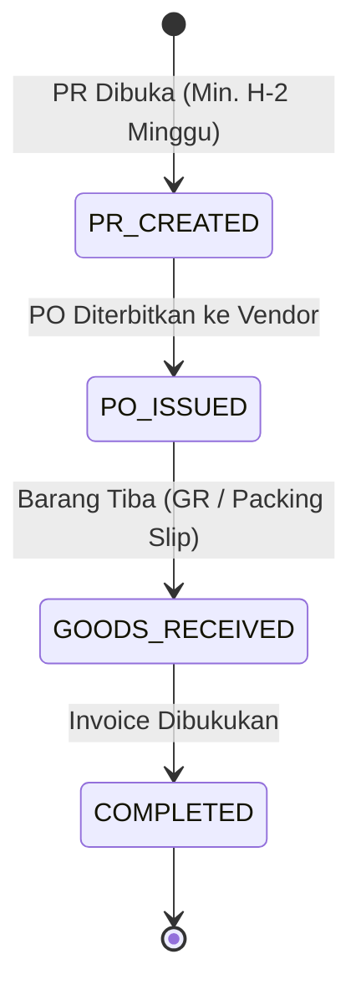

# Proses Bisnis & Alur Kerja Monitoring Anggaran QC

> PT Summit Adyawinsa Indonesia — Quality Control (QC) Department  
> Dokumen Standar Operasional & Logika Bisnis Sistem Monitoring Anggaran

---

## 1. Latar Belakang & Tujuan

Departemen Quality Control (QC) PT Summit Adyawinsa Indonesia mengelola alokasi anggaran tahunan untuk pemeliharaan peralatan uji, kalibrasi, pengadaan alat ukur (*tools*), dan perlengkapan operasional. 

Tantangan utama yang diselesaikan oleh sistem ini:
1. **Otomatisasi Kategori Budget & Trial Balance**: Mengeliminasi kesalahan penentuan kode akun formulir pengajuan PR/PO.
2. **Monitoring Realisasi Real-Time Berbasis Cost Control FA**: Membandingkan nominal rencana bulanan (*Finance Budget FA*) terhadap aktual belanja (*actual PR/PO expenditure*) dan penerimaan fisik (*Actual GR / Goods Received*).
3. **Pelacakan Siklus Procurement & Delivery Lead Time**: Memantau progress dari pembuatan PR hingga barang diterima (*Goods Received*) serta koordinasi berkala dengan POD/Purchasing.

---

## 2. Struktur Cost Center & Kode Trial Balance

Dalam sistem keuangan perusahaan:
- Formulir dasar tetap terbagi atas **CAPEX** (Belanja Modal/Investasi) dan **OPEX** (Biaya Operasional).
- Departemen Quality terbagi menjadi 2 Cost Center resmi:
  - **`123200`**: Quality QC (Operasional Laboratorium, CMM, Kalibrasi, Tooling, Inspeksi)
  - **`123000`**: Quality General / Managerial (Manajemen Mutu Umum, Perjalanan Dinas, Adm)

### Formula Kode Trial Balance:
$$\mathbf{Kode\ Trial\ Balance = Kode\ Akun\ GL - Cost\ Center}$$

| Kode Trial Balance | Kode Akun GL | Cost Center | Nama Akun / Deskripsi | Tipe |
|:---|:---|:---|:---|:---|
| **`50032902-123200`** | 50032902 | 123200 | CONSUMABLE EXPENSE (QUALITY - QC) | OPEX |
| **`60290100-123000`** | 60290100 | 123000 | MARKETING EXPENSES (QUALITY - GNRL) | OPEX |
| **`60290100-123200`** | 60290100 | 123200 | MARKETING EXPENSES (QUALITY - QC) | OPEX |
| **`60290300-123000`** | 60290300 | 123000 | SUPPLIES EXPENSES - OTHER (QUALITY - GNRL) | OPEX |
| **`60290300-123200`** | 60290300 | 123200 | SUPPLIES EXPENSES - OTHER (QUALITY - QC) | OPEX |
| **`60290500-123000`** | 60290500 | 123000 | TRANSPORTATION EXPENSE - LOCAL (QUALITY - GNRL) | OPEX |
| **`60290500-123200`** | 60290500 | 123200 | TRANSPORTATION EXPENSE - LOCAL (QUALITY - QC) | OPEX |
| **`60290600-123000`** | 60290600 | 123000 | TRANSPORTATION EXPENSE - OVERSEA (QUALITY - GNRL) | OPEX |
| **`60290600-123200`** | 60290600 | 123200 | TRANSPORTATION EXPENSE - OVERSEA (QUALITY - QC) | OPEX |
| **`60290800-123000`** | 60290800 | 123000 | STATIONARY G/A EXPENSE (QUALITY - GNRL) | OPEX |
| **`60290800-123200`** | 60290800 | 123200 | STATIONARY G/A EXPENSE (QUALITY - QC) | OPEX |
| **`60292000-123200`** | 60292000 | 123200 | REPAIR & MAINTENANCE (QUALITY - QC) | OPEX |
| **`12010100-123200`** | 12010100 | 123200 | TOOLS & EQUIPMENT / ASSETS (QUALITY - QC) | CAPEX |

---

## 3. Standarisasi Planning Item & Buffer Safety Markup (+30%)

Setiap PIC (Person in Charge) wajib mematuhi standarisasi penginputan rencana anggaran:

### A. Format Penamaan Item Planning:
$$\mathbf{MERK\ +\ NAMA\ ITEM\ +\ SPEC}$$
- **Contoh Penamaan yang Benar**:
  - `MITUTOYO DIAL GAUGE 0.01MM`
  - `OSG TAP DRILL M6X1.0 HSS-CO`
  - `HEIDENHAIN LINEAR SCALE 500MM`
  - `YOKOGAWA DIGITAL MULTIMETER 4.5 DIGIT`

### B. Aturan Unit Cost Markup Seragam (+30%):
- **Seluruh PIC diwajibkan menaikkan unit cost rencana anggaran sebesar +30% secara seragam.**
- **Rasional & Dasar Kebijakan**:
  1. **Kenaikan Harga Pasar**: Buffer ~10% untuk inflasi atau perubahan harga vendor saat PR diterbitkan.
  2. **Pajak & Bea (PPN)**: Buffer ~10%–11% untuk komponen perpajakan.
  3. **Mekanisme Termin / Utang Pembayaran Bulan Depan**: Mengakomodasi kurs fluktuatif dan biaya administrasi tempo pembayaran.
  4. **Pencegahan Overbudget**: Menghindari status *Overbudget* saat PO diterbitkan, sehingga estimasi rencana memiliki margin keamanan yang konsisten antar-PIC.

---

## 4. Alur Pembukaan PR, Lead Time, & Monitoring Kedatangan Fisik (POD)

Untuk memastikan pengadaan sinkron antara jadwal perencanaan dan eksekusi fisik:

### A. Lead Time Pengajuan PR:
- **Minimal PR dibuka 2 minggu sebelum bulan eksekusi/kebutuhan.**
- Contoh: Jika item dibutuhkan pada bulan Mei, maka PR wajib di-input dan disubmit paling lambat pertengahan April (H-2 minggu).

### B. Monitoring Kedatangan Barang & Tektokan POD / Purchasing:
- PIC bersama Admin QC wajib memantau status fisik barang secara aktif berkoordinasi dengan tim **POD / Purchasing**.
- Indikator kedatangan barang pada sistem:
  - **`PR_CREATED` / `PO_ISSUED`**: Proses administratif pembelian sedang berjalan.
  - **`GOODS_RECEIVED` / RECIEVE**: Fisik barang telah tiba dan terbit nomor Surat Jalan / *Packing Slip* / *GR Number*.
- Setiap pembukaan PR baru, PIC wajib memeriksa saldo tersisa dan status kedatangan pesanan sebelumnya agar tidak terjadi duplikasi atau barang menumpuk (*idle stock*).

### C. Jadwal & Deadline Anggaran Tahunan (Periode 2026):
- Status anggaran 2026 dibuka secara berkelanjutan karena alokasi masih tersedia (realisasi baru ~45%).
- **Bulan Terakhir Pembukaan PR**: **November 2026**.
- **Bulan Desember 2026**: **Closing Anggaran**. Pada bulan Desember tidak diperkenankan pembukaan PR baru; fokus sepenuhnya pada penyelesaian GR (*Goods Received*) dan verifikasi invoice.

---

## 5. Basis Anggaran Resmi: Cost Control FA

- Sistem menggunakan basis **Actual Finance Budget (Cost Control FA)** (~Rp 560.436.073,82 untuk periode 2026) sebagai acuan resmi, bukan estimasi planning awal (~Rp 661M).
- Komposisi Cost Control FA:
  - **Bulan Berjalan (Jan–Mar)**: Angka *Actual Finance* yang sudah dibukukan.
  - **Bulan Mendatang (Apr–Des)**: Angka *Plan Finance* yang disetujui.

---

## 6. Siklus Dokumen Procurement & Status Realisasi Anggaran

### Logika Status Anggaran (*Budget Status*):
- **`ON_PLAN`**: Pengeluaran PR/PO sesuai alokasi rencana anggaran bulanan.
- **`OVER_PLAN`**: Akumulasi pengeluaran PR/PO melebihi kuota planning item.
- **`UNDER_PLAN`**: Realisasi aktual di bawah rencana hingga penutupan periode.
- **`OOP` (*Out of Plan*)**: Pengadaan darurat/tambahan yang tidak ada dalam dokumen planning awal tahun.
